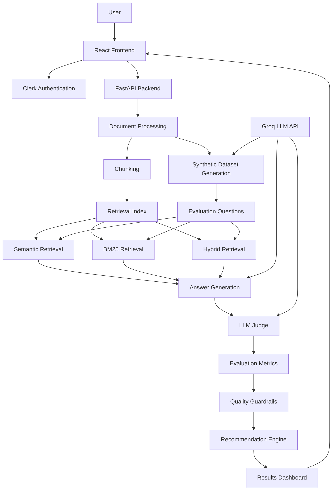
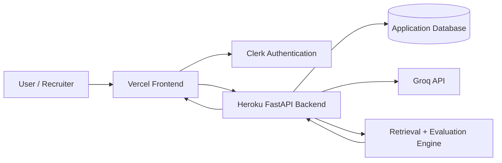

# Ragify — RAG Evaluation Harness

Ragify is an AI-powered evaluation platform for comparing different Retrieval-Augmented Generation (RAG) configurations and identifying which setup performs best.

Instead of manually guessing whether **Semantic Search, BM25, or Hybrid Retrieval** is better, Ragify evaluates them using retrieval metrics, answer-quality metrics, quality guardrails, and an automated recommendation engine.

> **Project Status:** MVP v1 — core end-to-end evaluation pipeline is functional and ongoing improvements are planned.

---

## Problem

Building a RAG application involves many choices:

- Which retrieval strategy should be used?
- What chunk size works best?
- What should Top-K be?
- Is the retriever finding the correct evidence?
- Are generated answers faithful to the source?
- Is the model hallucinating?
- Which configuration should be moved forward?

Manually testing every configuration is slow and inconsistent.

Ragify automates this evaluation process.

---

## What Ragify Does

```text
Upload Document
      ↓
Generate / Reuse Evaluation Dataset
      ↓
Run Retrieval Strategies
      ↓
Generate Answers
      ↓
Evaluate Answers
      ↓
Calculate Metrics
      ↓
Apply Quality Guardrails
      ↓
Compare Configurations
      ↓
Recommend Best Configuration
```

---

## Core Features

### Document-Based Evaluation

Users create a project and upload a knowledge document that will be used for RAG evaluation.

Current MVP support:

```text
.txt
```

Planned support:

```text
.pdf
.docx
.md
```

---

### Synthetic Evaluation Dataset

Ragify can automatically generate evaluation questions from the uploaded document.

Generated datasets can be reused between runs so different configurations are evaluated against the same questions.

This provides:

- Fairer comparisons
- Lower API usage
- Repeatable experiments

---

### Retrieval Strategies

Ragify currently evaluates:

- Semantic Retrieval
- BM25 Retrieval
- Hybrid Retrieval

---

### Configurable Parameters

Experiments can test settings such as:

```text
Retrieval Strategy
Chunk Size
Chunk Overlap
Top K
```

Example:

```text
Strategy: Semantic
Chunk Size: 120
Overlap: 20
Top K: 3
```

---

## Evaluation Metrics

Ragify evaluates both **retrieval quality** and **answer quality**.

### Retrieval Metrics

#### Hit\@K

Checks whether relevant evidence appears in the retrieved results.

#### Precision\@K

Measures how much of the retrieved content is relevant.

#### Recall\@K

Measures whether the system successfully retrieved the expected evidence.

#### MRR — Mean Reciprocal Rank

Measures how highly the first relevant result appears.

Higher MRR means useful evidence is appearing closer to the top.

---

### Answer Quality Metrics

#### Faithfulness

Checks whether the generated answer is supported by the retrieved context.

#### Correctness

Measures whether the answer correctly addresses the expected answer.

#### Relevance

Measures whether the answer is relevant to the user's question.

#### Hallucination

Measures unsupported information introduced by the generated answer.

Lower hallucination is better.

---

## Quality Guardrails

Before recommending a configuration, Ragify checks whether it passes predefined quality thresholds.

Possible failure categories include:

- Retrieval failure
- Low faithfulness
- Low correctness
- Low relevance
- Hallucination

A configuration can be excluded from recommendation if important guardrails fail.

---

## Recommendation Engine

After evaluating the configurations, Ragify compares their performance and recommends the strongest eligible configuration.

The Results page includes:

- Recommended strategy
- Recommendation score
- Guardrail status
- Retrieval metrics
- Answer-quality metrics
- Configuration settings
- Comparison with other strategies
- Strengths
- Weaknesses
- Failed queries
- Suggested next step

---

## Example MVP Result

One evaluation produced:

```text
Recommended Strategy: Semantic

Recommendation Score: 95.0%

Retrieval Quality
MRR: 100%
Recall@K: 100%

Answer Quality
Faithfulness: 100%
Correctness: 88.9%
Relevance: 100%
Hallucination: 0%

Guardrail Status:
All quality guardrails passed
```

This run used a small synthetic evaluation dataset, so it demonstrates that the evaluation pipeline works correctly but should not be treated as a statistically conclusive production benchmark.

Larger and more diverse datasets should be used for deeper evaluation.

---

# Architecture



---

# Tech Stack

## Frontend

- React
- TypeScript
- Vite
- Clerk Authentication

## Backend

- Python
- FastAPI
- Uvicorn

## AI / LLM

- Groq API
- OpenAI-compatible Groq models

## Retrieval

- Semantic Retrieval
- BM25
- Hybrid Retrieval

## Infrastructure

- Docker
- Docker Compose
- GitHub

Planned deployment:

```text
Frontend → Vercel
Backend → Heroku
```

---

# Running Locally

## 1. Clone the Repository

```bash
git clone <YOUR_GITHUB_REPOSITORY_URL>
cd rag-evaluation-harness
```

---

# Backend Setup

## 2. Create Virtual Environment

### Windows

```powershell
python -m venv .venv
.venv\Scripts\Activate.ps1
```

### macOS / Linux

```bash
python3 -m venv .venv
source .venv/bin/activate
```

---

## 3. Install Dependencies

```bash
pip install -r requirements.txt
```

---

## 4. Configure Environment Variables

Create a `.env` file in the project root.

Example:

```env
GROQ_API_KEY=your_groq_api_key

GROQ_BASE_URL=https://api.groq.com/openai/v1

GENERATION_MODEL=openai/gpt-oss-20b
EVALUATION_MODEL=openai/gpt-oss-120b
SYNTHETIC_DATASET_MODEL=openai/gpt-oss-20b
```

If authentication or database environment variables are required, add them according to your local configuration.

### Important

Never commit:

```text
.env
API keys
passwords
private credentials
```

Use `.env.example` to document required variables.

---

## 5. Start Backend

From the project root:

```powershell
python -m uvicorn backend.app.main:app --reload --port 8001
```

Backend:

```text
http://localhost:8001
```

FastAPI documentation:

```text
http://localhost:8001/docs
```

---

# Frontend Setup

Open another terminal:

```bash
cd frontend
npm install
```

Add frontend environment variables if required.

Example:

```env
VITE_API_URL=http://localhost:8001
```

If Clerk authentication is enabled, also configure the required Clerk frontend environment variable.

---

## Start Frontend

```bash
npm run dev
```

Frontend:

```text
http://localhost:5173
```

---

# Typical User Flow

```text
Sign Up / Sign In
        ↓
Create Project
        ↓
Upload Document
        ↓
Generate or Reuse Dataset
        ↓
Configure Evaluation
        ↓
Run Evaluation
        ↓
Compare Strategies
        ↓
Inspect Metrics
        ↓
View Recommendation
```

---

# Docker

The application can also be run using Docker.

## Build Containers

```bash
docker compose build
```

## Start Application

```bash
docker compose up
```

Or:

```bash
docker compose up --build
```

Run in background:

```bash
docker compose up -d
```

Check containers:

```bash
docker compose ps
```

View logs:

```bash
docker compose logs -f
```

Stop application:

```bash
docker compose down
```

---

# Docker Environment Variables

Do not hard-code API keys inside Dockerfiles.

Use environment variables through `.env` or deployment configuration.

Example:

```env
GROQ_API_KEY=your_key
```

Recommended `.gitignore` entries:

```gitignore
.env
.env.local
.venv/
node_modules/
__pycache__/
```

---

# Testing

## Backend Tests

```bash
python -m pytest -q
```

## Frontend Build Test

```bash
cd frontend
npm run build
```

A successful production build confirms that the frontend compiles correctly.

---

# Quick Evaluation vs Full Evaluation

Ragify can conceptually support two levels of testing.

## Quick Evaluation

Best for:

- Development
- Smoke testing
- Portfolio demonstrations
- Recruiter demos

Example:

```text
3–5 questions
Limited configurations
Lower API usage
Fast feedback
```

---

## Full Benchmark Evaluation

Best for:

- Serious RAG benchmarking
- Configuration selection
- Regression testing
- Production experiments

Example:

```text
15–30+ diverse questions
Multiple retrieval strategies
Reusable evaluation datasets
Deeper evaluation
```

Larger runs naturally require more LLM API calls.

---

# Why Dataset Reuse Matters

Synthetic question generation requires LLM calls.

Instead of regenerating questions for every experiment, Ragify can reuse the same evaluation dataset.

This provides:

### Lower API Cost

Questions do not need to be generated repeatedly.

### Fair Comparison

Every retrieval strategy is evaluated against the same questions.

### Repeatability

Experiments become easier to reproduce and compare.

---

# Current MVP Limitations

The current version focuses on proving the complete evaluation workflow.

These limitations are planned improvements rather than blockers to the MVP.

## Upload Formats

Currently supported:

```text
.txt
```

Planned:

```text
.pdf
.docx
.md
```

---

## Saved Run History

Evaluation results are generated successfully, but full saved-run reopening and historical experiment browsing are still being improved.

---

## Result UI

Some advanced query-detail sections require additional frontend rendering and UI polish.

---

## Evaluation Dataset Size

Small datasets are useful for quick demonstrations but are not sufficient for strong performance claims.

Larger and more diverse evaluation datasets are required for serious benchmarking.

---

## API Usage

Deep evaluation can require many LLM calls because the system may perform:

```text
Synthetic question generation
Answer generation
LLM judging
Multiple retrieval-strategy evaluations
```

Future improvements can reduce cost through:

- Dataset reuse
- Caching
- Smaller judge models
- Batching
- Configurable evaluation depth
- Quick vs deep evaluation modes

---

# Roadmap

## MVP v1

- [x] Authentication
- [x] Project creation
- [x] Document upload
- [x] Synthetic dataset generation
- [x] Dataset reuse
- [x] Semantic retrieval
- [x] BM25 retrieval
- [x] Hybrid retrieval
- [x] Retrieval metrics
- [x] Answer-quality metrics
- [x] Quality guardrails
- [x] Configuration comparison
- [x] Recommendation engine
- [x] Detailed results page

## Planned Improvements

- [ ] PDF support
- [ ] DOCX support
- [ ] Markdown support
- [ ] Saved evaluation history
- [ ] Reopen previous runs
- [ ] Query-result UI fixes
- [ ] Larger benchmark datasets
- [ ] Quick Evaluation mode
- [ ] Deep Evaluation mode
- [ ] API-call optimization
- [ ] Additional retrieval strategies
- [ ] Improved experiment tracking
- [ ] Production deployment

---

# Deployment Architecture



---

# Recruiter Demo Flow

A recruiter can explore the application through the following flow:

```text
Open Application
      ↓
Sign Up / Sign In
      ↓
Create Project
      ↓
Upload Knowledge Document
      ↓
Generate Evaluation Dataset
      ↓
Run RAG Evaluation
      ↓
Compare Semantic / BM25 / Hybrid
      ↓
Inspect Retrieval + Answer Metrics
      ↓
View Recommended Configuration
```

---

# Why This Project Matters

Most RAG demos focus on:

> “Can the system answer questions?”

Ragify focuses on a different engineering problem:

> **“How do we know which RAG configuration is actually better?”**

The project evaluates RAG systems using measurable metrics, automated experiments, guardrails, and explainable recommendations instead of relying only on manual testing.

---

# Project Status

**MVP v1 is functional.**

Current end-to-end flow:

```text
Document
→ Synthetic Dataset
→ Retrieval
→ Answer Generation
→ Evaluation
→ Metrics
→ Guardrails
→ Configuration Comparison
→ Recommendation
```

The project is actively being improved with broader file support, evaluation-history features, optimization, and production deployment.

---

# Author

**Maheen**

AI Engineering Project
